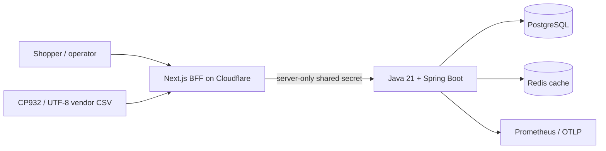

# V-Market Modernization

V-Market is a portfolio-grade commerce system built around a problem common in Japanese outsourcing work: replacing fragile Shift-JIS/CP932 file exchange with a controlled, observable system without interrupting daily operations.

The public storefront is deployable to Cloudflare Workers. A Java 21/Spring Boot API owns the catalog, transactional checkout, inventory, fulfillment, legacy imports, and reconciliation. PostgreSQL is the source of truth; Redis is a fail-open catalog cache.

## Live demo

- Application: [v-market.vmarket-vietdung2005.workers.dev](https://v-market.vmarket-vietdung2005.workers.dev)
- Backend readiness: [v-market-api.onrender.com/actuator/health/readiness](https://v-market-api.onrender.com/actuator/health/readiness)
- Public deployment proof: [docs/evidence/live-deployment.md](docs/evidence/live-deployment.md)
- Short-lived AWS deployment proof: [docs/evidence/aws-deployment.md](docs/evidence/aws-deployment.md)

The backend uses Render's free web-service tier, so the first request after 15 minutes without inbound traffic can take about a minute while the container wakes up.

## Demonstrated capabilities

These describe the current locally verified source. The live demo/deployment evidence may still represent an earlier revision; this remediation has not been pushed or deployed yet.

- Durable guest checkout with server-owned JPY pricing, guest-capability-scoped idempotency, deterministic lock order and oversell protection (local remediation).
- Random 256-bit tracking capabilities, hashed lookup and encrypted 24-hour replay copies; tracking responses exclude customer PII.
- Audited, one-step fulfillment transitions in an operations console.
- Strict UTF-8/CP932 CSV intake, bounded staging, quarantine, checksum deduplication, async dispatch and bounded abandoned-execution recovery with business/Batch metadata fencing (local remediation; see evidence for rollout status).
- Versioned supplier contracts, read-only mapping preview and explicit confirmation in the existing ops ledger, with global original-byte dedup and stock/product-version guards. See the [synthetic supplier onboarding case](docs/fde/customer-problem.md), [acceptance evidence](docs/fde/acceptance-criteria.md), and [demo/handoff](docs/fde/customer-demo-script.md). This feature is local, not deployed.
- Redis metadata cache-aside with TTL, after-commit invalidation, fail-open fallback and metrics; stock/active eligibility read from PostgreSQL on every catalog request.
- BFF trust boundary: browser requests never receive the backend or operations secrets.
- Prometheus metrics, health probes, Micrometer tracing/OTLP support, and request correlation IDs.
- Non-root Docker image, local Compose stack, Kubernetes Helm chart, and three-lane GitHub Actions CI.

## Architecture



Cloudflare is the long-lived free frontend host. The same backend image has been verified on ECS with managed RDS and Redis without changing browser contracts. AWS is reproducible, short-lived evidence and is not a permanent dependency of the public demo.

## Run locally

Requirements: Node.js 24, Java 21, and Docker.

```bash
cp .env.example .env.local
docker compose up -d postgres redis
cd backend && ./mvnw spring-boot:run
# in another terminal, from the repository root
npm ci && npm run dev
```

Use `http://localhost:3000` for the storefront, `/track` for customer tracking, and `/ops` for migration/reconciliation/fulfillment operations.

### Operator access (local remediation branch)

The storefront remains public; `/ops` now requires an operator login. BFF/operations service secrets alone do not grant user access. PostgreSQL stores accounts and Spring Session data (migration V4); mutations require CSRF tokens, and logout/revocation invalidate access.

Set `AUTH_BOOTSTRAP_USERNAME` and `AUTH_BOOTSTRAP_PASSWORD_HASH` in the **backend process environment** before first startup. Use a BCrypt hash, never a plaintext password or public demo password. No account is provisioned when both are blank; existing accounts are not overwritten. Spring Boot does not automatically load the frontend's `.env.local`.

`AUTH_SECURE_COOKIE=true` is the default and required in production. For local HTTP only, set it to `false` (Compose already does this). The idle session timeout is 15 minutes. Disable an account or change its role in `auth_account` to revoke access on its next request. Password recovery/account administration UI is not provided.

Login has a PostgreSQL-backed budget of 10 attempts/minute per backend peer address. Behind a shared BFF this is deliberately a shared budget, not an end-user-IP guarantee; forwarded client-IP headers are not trusted. Production must use HTTPS and platform ingress limits.

Real local browser verification (after backend package and frontend build; do not rebuild while it runs):

```powershell
pwsh -NoProfile -File tools/verify-operator-session.ps1
```

This uses disposable local databases and temporary QA credentials, not production data. Changes described here are local until a coordinated backend/frontend deployment; see [remediation evidence](docs/evidence/remediation-2026-10-18.md).

## Stock import contract (local remediation)

The supplier onboarding extension is a separate reviewed entry point over the **same** importer: it enriches three-column supplier files from the catalog **at preview**, requires signed explicit confirmation and preserves the original file checksum. It does not prove the source file's business freshness before review. The direct legacy/snapshot contracts below remain supported. See [integration contract](docs/fde/integration-contract.md).

Five-column legacy files (`sku,vendor_code,name,on_hand,price_minor`) update **names/prices only**. Their `on_hand` values do not write inventory or generate stock movements. The result reports `importMode=METADATA_ONLY`; stock reconciliation is explicitly unverified.

For stock adjustments, sign in to `/ops` and select **Load current stock snapshot**. The protected `GET /api/ops/inventory/snapshot` exports a coherent PostgreSQL snapshot:

```csv
schema_version,sku,vendor_code,name,on_hand,price_minor,expected_stock_version
2,VM-001,NAMI,AeroKnit travel jacket,32,11000,0
```

The example version is illustrative: always retain the version actually exported by the backend. Edit quantities and upload the versioned file. A sale/import that changed a row's stock version causes `STALE_STOCK_VERSION`; the whole row (including metadata) is rejected before any update. The backend does not assign a fresh expected version when uploading an old vendor file. Versions are concurrency tokens for authorized operators, not signed proof of a vendor's data origin or metadata freshness.

All occurrences of duplicate normalized SKUs are quarantined. Stock, movement, applied quantity/version, row marker, and job counters commit together. Checkout/import share ordered product/stock locks; import metrics/cache invalidation happen after commit. Catalog requests read stock and active product/vendor eligibility from PostgreSQL even on a metadata-cache hit; this is a snapshot, not a reservation or a promise that another sale cannot happen immediately afterward.

CSV input is limited to **5,000,000 bytes and 1,000 data records** (the header is not a data record). Decoding reports malformed/unmappable UTF-8/CP932 instead of replacing characters. Duplicate/missing required headers, wrong field counts and malformed CSV reject the file before staging. Valid structure with invalid business values is still quarantined per row. Unique additional columns remain allowed but every record must match its header width. Encoding aliases are normalized by the existing UTF-8/CP932 policy; no Unicode/newline/BOM normalization or semantic deduplication is promised.

The BFF counts request bytes while reading, cancels oversize streams and returns 413; CSV has the budget above and other bodies have 65,536 bytes. Java independently bounds controller body reads before byte-array/JSON deserialization, including unknown-length streams, with the same CSV/JSON budgets and `REQUEST_TOO_LARGE` response. These are application body budgets, not claims about provider buffering, slow-client timeouts, or login form limits at the servlet layer. Direct service calls retain byte validation as defense in depth.

Reconciliation compares the **applied** stock/product baseline. A higher version is marked `changedSinceImportRows`; stock without a comparable baseline counts as `stockNotVerifiedRows`. Zero mismatches alone is not stock verification. Same-version quantity/price drift and version regression remain discrepancies; reports do not repair data. Historical uploads remain `LEGACY_UNVERIFIED`, without fabricated proof; pending historical rows require a new upload. Apply V5/V6 before the new backend and then deploy its matching frontend.

## Async import and controlled restart (local remediation)

The operations UI sends `Prefer: respond-async` on upload and restart. Upload returns **202** after staging/work commit, with a job summary and `Preference-Applied: respond-async`; acknowledgement is not a successful apply. Restart of a caught FAILED job durably requeues the same identity and returns 202. Completed restart replay returns 200 without launching again. Active/STAGED jobs or a busy job-row lock return 409 `IMPORT_CONFLICT`. Every mutation still requires the operator session, CSRF and server-owned trust credentials.

The UI displays the latest 20 jobs, polls STAGED/RUNNING work every two seconds in a visible tab, pauses automatic polling on a status-read error, and offers manual refresh. Only FAILED jobs have a restart button. A lost request response is an unknown outcome: refresh before resubmitting; there is no automatic mutation retry or local declaration of failure/success. Partial accepted/rejected counts remain visible. This is not a complete console for blocked/expired ownership or historical job pagination.

For compatibility, clients without `Prefer: respond-async` retain synchronous upload (201) and restart (200) semantics. The BFF forwards the preference and its acknowledgement. Byte-identical concurrent uploads serialize lookup/staging with an advisory transaction lock and retain the existing global checksum identity. Source filename is a label, not a way to run the same file again. Encoding is validated before duplicate lookup; the same bytes with a conflicting canonical encoding return 409 for review, not a new job. Aliases of the same encoding share identity. Different bytes (including newline or actual encoding changes) remain a different checksum; this is not semantic/vendor-scoped deduplication. A duplicate does not automatically restart failed work or convert old synchronous work to async.

Redis key `vmarket:catalog:metadata:v2` stores only metadata and has a five-minute TTL. Old `vmarket:catalog:v1` entries are ignored and expire naturally. Name/price/list membership can remain stale until refresh, and a reader-fill/invalidation race is still possible; this is not strong cache consistency or a hard post-commit freshness SLA. Current active eligibility filters cached entries, stock is never taken from Redis, and checkout reloads/locks canonical price and inventory.

The tasklet processes one group per invocation without an outer business DB transaction; `ImportChunkService` owns each short transaction. Already committed groups survive a later failure. Stock version checks still apply on restart: later sales can cause pending rows to be rejected, not overwritten.

The backend dispatcher claims one explicitly async READY item per fixed-delay tick (two-second startup delay, one second after the previous tick returns). Job-row `SKIP LOCKED` plus token/generation fencing coordinates multiple instances. There is no in-memory task queue or unbounded executor. `IMPORT_WORKER_ENABLED=true` is the default backend setting; set false only to pause dispatch, not to accept a false completion claim. Only `dispatch_requested=TRUE` work enters the dispatcher (V8); old synchronous work is not stolen.

Caught chunk failure persists FAILED even when JobLauncher returns normally; the worker does not automatically retry it. READY work survives a process restart. Explicit async CLAIMED work with an expired lease now enters bounded recovery: job/work locks serialize it with business and fenced Batch metadata writers, retire a matching abandoned execution, and requeue the same JobInstance without clearing applied markers. Completed metadata is acknowledged without another execution. UNKNOWN/mismatched metadata or exhausted recovery allowance becomes BLOCKED for review. Independent heartbeat, full query/lock timeout bounds and comprehensive crash-window coverage remain pending; no exactly-once or availability/SLA claim is made.

Spring Batch 5.2 legacy metrics retain `spring.batch.*`; Observation timers/traces use separate `vmarket.import.job` / `vmarket.import.step` names to avoid incompatible active-timer tag sets. Observation metric presence/registration is tested against a real Prometheus registry, not just a simple test registry.

### Durable work ownership (V7, local only)

Staging and an `import_work_item` are committed in the same PostgreSQL transaction. Work states are `READY`, `CLAIMED`, `FINISHED`, `FAILED`, and `BLOCKED`. A short claim transaction locks job then work, assigns a random token, increments the generation, and grants a 60-second lease using the DB clock. There is no lease token in the public API or Batch JobParameters/logged launcher parameters: only the non-identifying generation accompanies the execution, preserving the same JobInstance on restart.

Every chunk locks job/work and verifies the current token, generation, state, and lease before writing; it renews after processing the group. Failed renewal rolls the entire group back, including markers/movements/counters and after-commit effects. Empty-work finalization and caught-failure bookkeeping also require current ownership. A stale worker cannot adopt a newer generation or mark its job FAILED. Fixed 60 seconds is a fail-closed safety bound, not an SLA; a blocked/slow group can exhaust it. There is no independent heartbeat thread yet.

`takeOverExpired` remains an internal ownership-only primitive; it must not replace `ImportRecoveryService`. The dispatcher attempts one expired async candidate before claiming READY work. Recovery uses a shared transaction for generation revocation, standard Spring Batch metadata updates, and requeue/acknowledgement. At most three recoveries are allowed; the next loss requires review. An individual recovery exception rolls back and is logged without raw exception text; unrelated READY work can still run. A damaged recovery candidate itself may require manual inspection, and the UI is not a full recovery console.

The import job, step and synchronous launcher explicitly use `fencedImportRepository`. Every metadata mutation requires the current in-thread claim, matching generation and DB-clock lease under the job/work lock protocol. Its standard JDBC repository delegate joins that same transaction; it must not independently commit metadata. Business completion retains the claim until Batch completion is persisted and acknowledged, rather than releasing ownership before final metadata writes. Do not switch the launcher to an asynchronous executor without redesigning scope propagation.

V7 maps historical completed/failed jobs to terminal work states with generation 0 and no fabricated owner. Other historical jobs become BLOCKED for review. For rollout, quiesce imports and drain/stop old workers before V7/new backend: old binaries do not enforce fencing and must not run beside new workers. Do not downgrade to an unfenced binary while work is active. No live rollout has occurred for this remediation.

Apply V8/V9 as well before deploying this dispatcher/backend and its async UI, and stop all old unfenced binaries first. The real browser runner verifies READY-before-launch restart, plus a STARTED process crash after 50 of 51 stock movements have committed. The STARTED scenario uses a temporary DB sleep trigger, force-stops only its owned Java PID, ends the orphaned test query, and injects lease expiry before restart; it does not measure natural lease timing or recovery SLA. It also injects/removes a controlled DB failure to test FAILED → UI restart → COMPLETED. All datasets and processes are disposable; see the evidence file for actual results and limits.

## Verification

```bash
npm run verify
npm audit --audit-level=high
npm run build:worker
cd backend && ./mvnw verify
docker compose config --quiet
docker build -t v-market-backend:local backend
helm lint infra/helm/v-market
```

Backend integration tests launch PostgreSQL 17 and Redis 8 with Testcontainers. See [docs/EVIDENCE.md](docs/EVIDENCE.md) for the requirement-to-proof matrix and [docs/ARCHITECTURE.md](docs/ARCHITECTURE.md) for design trade-offs.

### Frontend dependency maintenance

Node 24 is used locally and in CI. The current remediation pins Next 16.4.2, OpenNext Cloudflare 1.20.12, Wrangler 4.151.1 and Vitest 4.1.12. CI builds both Next and the Cloudflare Worker bundle; the Worker build does not deploy or need production credentials. A successful Node build alone does not prove adapter compatibility.

Avoid global cross-major overrides: `brace-expansion` v5 cannot replace the v2 API expected by minimatch v9. Both branches resolve their compatible patched versions in the lockfile. The remaining scoped `@node-minify/core → glob@10.5.0` override patches an upstream exact 10.3.3 pin without changing Glob's major API; remove it once upstream pins a patched version. Glob v10 still emits a deprecation warning even though this patched version passes the recorded audit. Audit is a time-specific advisory check, not a guarantee of zero vulnerabilities. See the remediation evidence for commands, compatibility results and remaining deployment gates.

## Secrets and deployment

Copy only variable names from `.env.example`; never commit real values. Production startup rejects the documented local secrets. `BFF_SHARED_SECRET` and `VMARKET_OPS_SECRET` must be different random values of at least 32 characters in production.

`CHECKOUT_REPLAY_KEY` is an additional **backend-only**, base64-encoded 32-byte random AES key. The documented zero key is local-only and rejected in production, including alternate Base64 padding of the same bytes. Generate a key once and provision the same value to every backend instance/restart; never generate it at application boot or expose it with `NEXT_PUBLIC_`. Compose supports it and Helm expects it in the existing Secret. The current implementation has one active key, not a rotation keyring: changing/loss of the key makes protected replay fail closed (409) for affected orders, while original tracking links remain valid. Plan/retain decrypt capability for the entire active replay window before rotating.

### Guest checkout identity and replay (local, not yet deployed)

`POST /api/orders` now also requires `X-Checkout-Session`: a 64-character lowercase hex guest bearer capability. The browser creates 32 random bytes once per tab and stores this capability in sessionStorage; the BFF forwards it without treating it as an operator login. PostgreSQL stores only its hash and a domain-separated scope/operation/key hash, never the raw capability or raw new request key. Different capabilities may use the same raw key without sharing an order. Same capability/key + matching canonical request replays the existing order; a different payload conflicts. This is a guest namespace, not verified customer identity or cross-device account recovery. Protect it from XSS; clearing/cloning tab storage changes/shares the capability boundary.

New order IDs and tracking tokens are random. The token lookup remains SHA-256; an AES-GCM replay copy is bound to the order ID and stored alongside the order. Retry never creates/rotates a token to repair missing/corrupt ciphertext. Within 24 hours of the DB-clock creation timestamp, a valid retry returns the original token/totals and current statuses. After that, the key stays reserved and retry returns 409 for review. The original tracking link remains usable independently of replay expiry. A minute-based cleanup clears up to 100 expired ciphertexts with SKIP LOCKED per tick; it does not delete orders, hashes, key tombstones or extend the replay window. Cleanup is best effort, not guaranteed erasure at precisely hour 24.

V10–V13 are additive: historical orders receive no invented guest owner, and no tracking hash/token is rotated. A raw key matching an unscoped historical order fails closed for review instead of silently creating a scoped duplicate. Original legacy tracking links continue to use their existing hashes. Stop old unfenced checkout writers and pause checkout mutations before rollout; provision the stable replay key, migrate, deploy backend and matching frontend together, then smoke. Old clients without the new header fail with 400; mixed-client zero-downtime rollout is not promised.

The storefront persists the operation UUID, canonical payload hash, guest-capability hash, phase and timestamp **before** sending checkout. No customer payload or tracking token is stored in this record. Reload restores the lock without auto-submitting; changed details cannot reuse an unresolved operation. `GET /api/orders/checkout` with the same guest/key retrieves a committed response within the replay window. A 404 means “not observed”, not “failed”; the original request can still arrive.

`POST /api/orders/checkout/cancel` closes only an unused key under the same transaction lock as creation. V13 stores its hash permanently; later creation returns 410. It cannot cancel/refund an existing order (409). Close waits have 3s lock/8s statement/10s transaction limits. A serialized 10,000-record demo capacity rejects new closures with 503 instead of deleting safety records; repeated closure of an already closed key still succeeds. This bounds storage, not abuse/availability: ingress rate limiting and a larger-scale archival design remain separate work.

Only a confirmed response or durable close permits explicit acknowledgement/new checkout. A lost close response is recoverable through GET 410; storage errors, changed guest identity and stale component responses cannot silently replace the key. The browser aborts requests after 15s, but this does **not** cancel committed backend work. Java checkout waiting now has the layered budgets below, not a hard end-to-end deadline. Clearing storage, using a different tab/device, or XSS can still lose/share the bearer boundary; this is not account recovery or exactly-once delivery.

### BFF waiting and failure contract (local remediation)

The BFF allows 10 seconds to read an upload, then a separate 12 seconds for upstream headers **and the complete body**. Responses are buffered before forwarding, with a 5,000,000-byte budget; this BFF is for bounded JSON/CSV, not SSE/download streaming. Slow uploads return 408, oversized uploads 413, unreadable input 400. Upstream timeout returns 504 `BACKEND_TIMEOUT`; network/server 5xx errors become sanitized 503 `BACKEND_UNAVAILABLE`, including backend-specific 503 codes. Malformed declared JSON or oversized responses return sanitized 502. Valid business 4xx responses, CSV bytes, session cookies and preference headers remain available. All these responses are no-store; the BFF never automatically retries a mutation.

Timeout, malformed response or 5xx **does not prove rollback**. Keep the original guest/key and recover the operation; do not submit a replacement key. Request abort only stops BFF waiting/transport, not Java transactions. Budgets start inside the handler and are event-loop deadlines, not hard end-to-end guarantees or ingress/concurrency limits. Buffering consumes memory per concurrent request; platform rate/concurrency policy remains separate work. A Render cold start can exceed the BFF budget: the UI returns an error sooner; after the backend warms, explicitly check the same operation rather than increasing every timeout or replaying writes blindly.

### Java checkout database waiting (local remediation)

Create, scoped recovery and close-unused use 10-second Spring transactions plus transaction-local PostgreSQL lock/statement limits of 3/8 seconds. Local settings reset at transaction end, rather than changing all sessions. The shared Hikari pool waits up to 2 seconds for an available connection and uses 1-second validation; pgJDBC defaults here set connect/login 3s, socket read 15s and cancellation-channel timeout 2s, with TCP keepalive enabled.

Data-access/transaction failures return sanitized backend 503 `DATABASE_UNAVAILABLE`, without SQL/connection credentials. The BFF exposes its generic 503 contract. Existing close-unused lock contention remains 409. Real PostgreSQL tests hold both stock/advisory locks, exhaust the pool, and run a slow late audit; they verify no orphan order/movement, intact stock after rollback and successful same-key retry after clearing the fault. Do not infer rollback from every production 503: failed commit acknowledgement can still be ambiguous.

These limits protect different waits, not an additive latency SLA or a promise that Java always finishes before the BFF. Spring timeout is applied through JDBC statements; network cancellation/commit acknowledgement can take longer. Driver/pool settings affect all datasource users, including imports and Flyway, so long maintenance work needs explicit review/overrides. Connection URL/deployment overrides can change effective settings. This phase does not prove packet-loss recovery, cover every servlet/auth/Redis/OTLP wait, or replace ingress/concurrency limits.

The current Cloudflare deployment points to the live Render backend through a server-only `BACKEND_ORIGIN`; provider secret stores hold the BFF and operations credentials.
