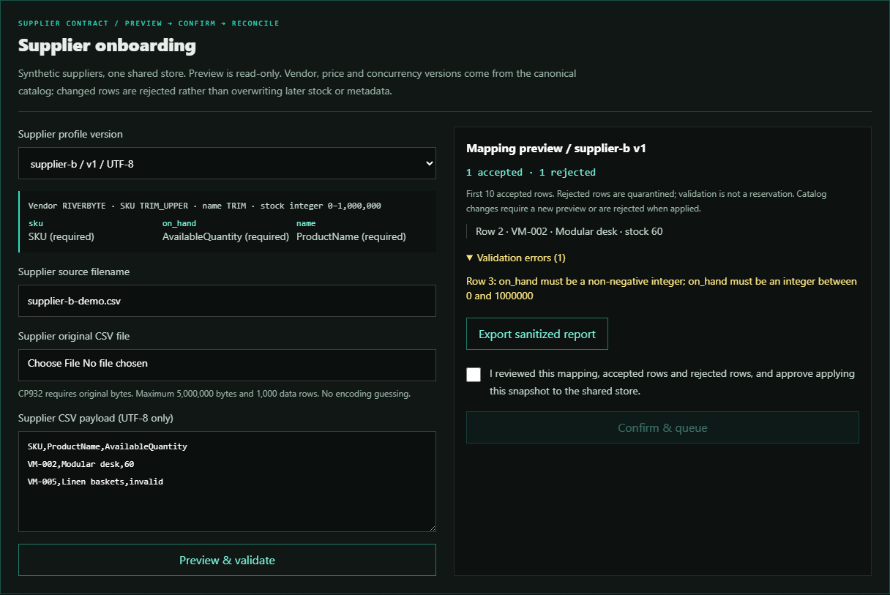

# V-Market — Commerce & Supplier Data Onboarding

A commerce application that helps operators review supplier inventory files, approve valid changes and reconcile the resulting stock—without applying the same file twice.

[Live storefront](https://v-market.vmarket-vietdung2005.workers.dev/) · [Operations console](https://v-market.vmarket-vietdung2005.workers.dev/ops) · [Measured results](docs/fde/impact-evaluation.md) · [Run locally](docs/developer-guide.md)

## Problem & Solution

**Problem:** Supplier data often arrives as spreadsheets or CSV files with different column names, Japanese character encodings and invalid values. Importing a file without review can corrupt stock. Retrying after a connection failure can apply the same update twice, while a stopped import leaves operators unsure what was actually changed.

**Solution:** V-Market provides a **Preview → Confirm → Import → Reconcile** workflow. An operator selects a versioned supplier format, sees which rows are valid, explicitly approves the original file and checks the final inventory against recorded changes. Invalid rows are separated with reasons instead of silently accepted.

The same application includes a customer-facing catalog, checkout, order tracking and an operations console. Supplier onboarding is the main engineering case study.

View the supplier preview screenshot

## Engineering

- **Japanese data compatibility:** Strict UTF-8 and CP932 decoding, with versioned mappings from supplier columns to the application's stock format.
- **Review before change:** Preview does not update inventory. Confirmation is bound to the reviewed file and supplier profile; changed stock or product versions are rejected rather than silently overwritten.
- **Duplicate protection:** The original file's digital fingerprint prevents a byte-identical upload from creating another import job.
- **Recoverable processing:** Imports save progress in small committed groups. An interrupted job resumes stored work instead of starting a second inventory update.
- **Explainable results:** Operators can inspect rejected rows, import progress and reconciliation differences.
- **Commerce safety:** Server-owned prices, stock locking and retry-safe checkout protect order and inventory consistency.

**Core stack:** Java 21, Spring Boot, Spring Batch, PostgreSQL, Redis, React/Next.js and TypeScript. Docker and GitHub Actions support repeatable delivery.

## Impact & Results

**Synthetic local measurements, not production throughput or unit-test counts.** The recorded dataset contains 220 source rows: 200 valid existing catalog items and 20 deliberately invalid numeric rows.

| Situation | Measured outcome | Why it matters |
| --- | --- | --- |
| Mixed-quality supplier data | **200 rows accepted; 20 rejected** before application | Invalid values are identified rather than applied as stock updates. |
| Review and process the file | Preview took **51.07 ms**; preview through completed import took **1.196 seconds** | Demonstrates a usable review-to-import path for this specific 220-row sample. |
| Confirm the identical file again | Still **1 job and 200 inventory movements** | A repeated confirmation does not apply the 200 stock changes twice. |
| Check the final stock against recorded movements | **0 reconciliation mismatches; 0 unverified stock rows** | Every stock row in this measured scope has comparable reconciliation evidence. |
| Interrupt an import after 50 of 51 rows are committed | Restart finishes with **51 applied rows, 51 unique movements and 1 job instance** | Progress is recovered without duplicating the first 50 stock updates. |

**Evidence:** [Benchmark data](docs/fde/evidence/benchmark.json) · [Crash-recovery data](docs/fde/evidence/recovery.json) · [Method and limitations](docs/fde/impact-evaluation.md).

Timing is from **one local run** on Windows 11, Java 21, PostgreSQL 17.6 and Redis 8.2. It excludes environment startup, HTTP/WAN latency and production contention. Recovery used an actual owned Java process restart and a paused disposable database; lease expiry was accelerated for the exercise. There is no measured before/after manual-work baseline, so no staff-time savings or speedup percentage is claimed.

## Explore the project

- **For the business scenario:** [Supplier onboarding problem](docs/fde/customer-problem.md) · [Demo walkthrough](docs/fde/customer-demo-script.md).
- **For engineering detail:** [Integration contract](docs/fde/integration-contract.md) · [Architecture](docs/ARCHITECTURE.md).
- **For reproducibility:** [Acceptance evidence](docs/fde/acceptance-criteria.md) · [Developer guide](docs/developer-guide.md).
- **For support:** [Operator handoff](docs/fde/operator-handoff.md).

### Demo boundaries

A personal portfolio project using fictional suppliers and a shared demo store—not a real retailer deployment or a multi-tenant supplier portal. The frontend runs on Cloudflare; the Java backend uses Render, Neon PostgreSQL and Upstash Redis. Free-host startup can delay initial requests. Import/administration requires a provisioned operator account; credentials are not published.

The importer updates existing catalog items; it does not create arbitrary products or connect to a real supplier system. Duplicate protection covers identical file bytes, not every differently formatted file representing the same business event.

---

Former repository name: `Project2`. The new name changes the repository address, not the live-demo URL.
