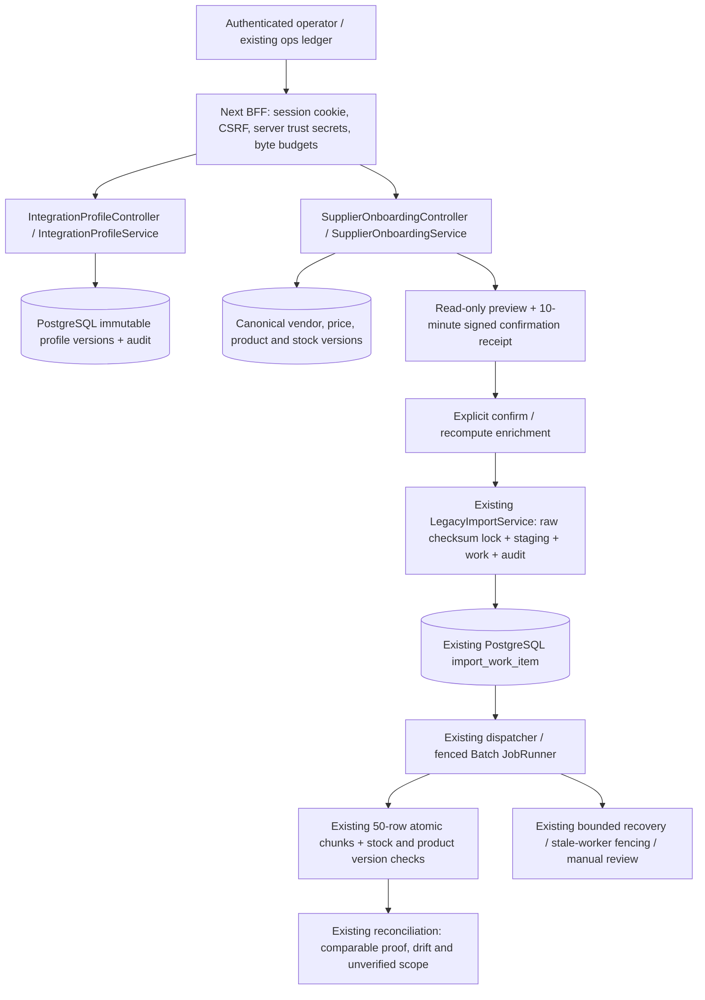

# Customer problem: controlled supplier onboarding

## Fictional customer and outcome

A fictional Japanese retailer operates **one shared V-Market store**. Supplier A sends Japanese CP932 inventory files; supplier B sends English UTF-8 files. Operators otherwise translate headers and enrich missing catalog fields by hand. A wrong mapping, duplicate upload or stale snapshot can damage inventory; a failed process must not repeat already committed adjustments.

This is an engineering portfolio scenario with synthetic suppliers and datasets, not a customer deployment or a claim of saved labor. OPERATOR accounts administer the shared store; profile vendor binding is a validation rule, **not tenant isolation**.

## Acceptance outcome

An operator selects an immutable, active mapping version, previews original bytes without business writes, inspects rejected rows, explicitly confirms, observes a durable import, and reconciles applied stock proof. New supplier column contracts do not require changes to checkout or a new queue.

## Architecture / actual extension boundary

Source paths (relative to repository root):

- `backend/src/main/java/dev/vmarket/migration/IntegrationProfileService.java` — declarative definitions and audit.
- `backend/src/main/java/dev/vmarket/migration/SupplierOnboardingService.java` — strict decoding, mapping, batched enrichment, preview receipt and confirm.
- `backend/src/main/java/dev/vmarket/migration/LegacyImportService.java` — reused parser, global raw-byte dedup, staging, inspection and restart.
- `backend/src/main/java/dev/vmarket/migration/ImportChunkService.java` — original atomic application plus supplier product-version guard.
- `backend/src/main/java/dev/vmarket/migration/ImportRecoveryService.java`, `ImportRepositoryFence.java` — unchanged ownership/recovery machinery.
- `backend/src/main/java/dev/vmarket/reconciliation/ReconciliationService.java` — unchanged reconciliation.
- `components/supplier-onboarding.tsx`, `components/import-inspection.tsx`, `components/operations-console.tsx` — existing app extension.
- `lib/operations-api.ts`, `lib/backend-proxy.ts`, `app/api/ops/` — typed calls and server-only trust boundary.
- `backend/src/main/resources/db/migration/V14__supplier_integration_profiles.sql` — additive schema; V1–V13 unchanged.

## Deliberate trade-offs

| Choice | Benefit | Cost / boundary |
| --- | --- | --- |
| Immutable declarative versions, only built-in rules | Reviewable contracts, stable staged data | No supplier-authored scripts or UI mapping editor; publish via protected API |
| Canonical enrichment for three-column supplier files | Suppliers need not invent prices/vendor/version values | Preview is relative to the current catalog; changed data may require re-preview |
| Operator-approved stock snapshot | Works with the supplied three-column contracts | Cannot infer supplier data age before preview; trusted source sequence/as-of policy is a future integration requirement |
| Stock **and product** version checks under locks | Cannot silently restore sold stock or overwrite a later canonical price | Stale rows are quarantined, not auto-merged |
| Stateless signed preview receipt | Dry-run writes no committed import state | Shared stable ops secret and reasonably synchronized clocks required; receipt expires after 10 minutes |
| Global raw-byte dedup | Renames/profile changes cannot silently replay the same file | Different byte encodings/newlines are different identities, not semantic dedup |
| Existing PostgreSQL queue/recovery | No extra broker or competing recovery protocol | Existing lease/recovery and manual-review limitations remain |

See [mapping](source-to-target-mapping.md), [contract](integration-contract.md), [acceptance](acceptance-criteria.md), [handoff](operator-handoff.md), [demo](customer-demo-script.md), and [measured impact](impact-evaluation.md).
